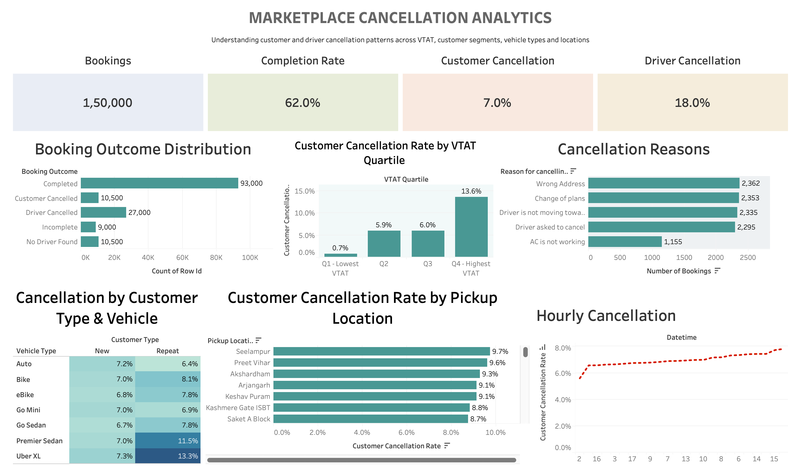
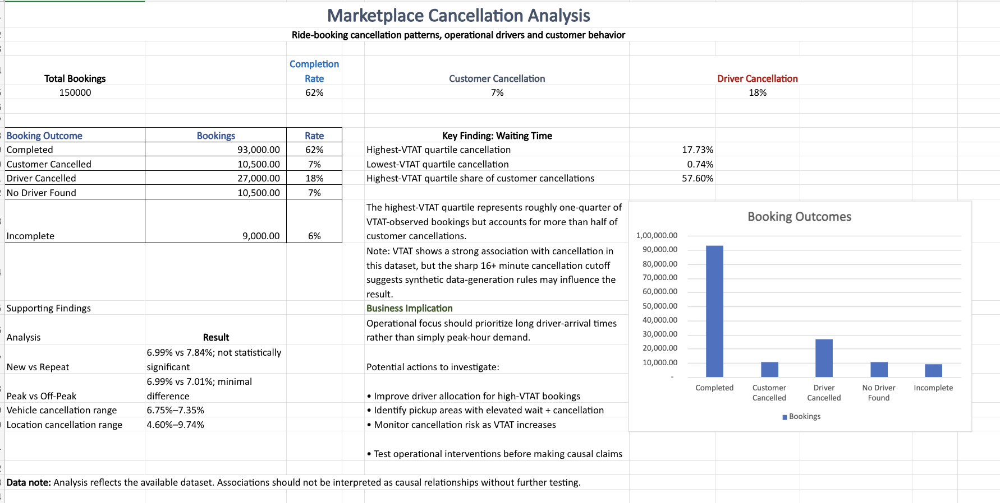

 <div align="center">


<br>

<p>
  
  
  
  
  
  
</p>

<h3>Understanding Customer Cancellation, Waiting-Time Patterns & Marketplace Operations</h3>

<p>
  <i>
    An end-to-end marketplace analytics case study using 150,000 public ride-booking records.
    The project examines customer cancellation patterns across vehicle arrival time (VTAT),
    customer segments, time, vehicle types, pickup locations, and reported cancellation reasons.
    It combines Python, SQLite SQL, statistical analysis, Excel reporting, and a Tableau dashboard.
  </i>
</p>

</div>

---

## 📊 Executive Dashboard

<p align="center">
  
</p>

<p align="center">
  <strong>Executive view of booking outcomes, customer cancellation, VTAT patterns, customer reasons, time, vehicle segments, and pickup locations.</strong>
</p>

## 📘 Excel Executive Summary

<p align="center">
  
</p>

<p align="center">
  <strong>One-page summary of the core KPIs, analytical findings, and operational investigation areas.</strong>
</p>

> **Workbook note:** The Tableau workbook is maintained in [`dashboard/Project1.twb`](dashboard/Project1.twb). It uses a file-based data connection and may need to be reconnected to the analysis-ready CSV when opened on another computer. The screenshots above provide a quick view of the completed dashboards.

---

# 🎯 Business Problem

On-demand marketplaces depend on a successful sequence of events: a customer places a booking, the platform finds and assigns a driver, the customer waits for pickup, and the ride is completed. A booking can fail at several points in this journey.

This project investigates **customer cancellations** in a ride-booking marketplace-style dataset. The goal was to understand how cancellation patterns vary across waiting time, customer behavior, time of day, vehicle type, pickup location, and customer-reported reasons.

The analysis began with three central hypotheses:

1. **Price:** Is booking value associated with customer cancellation?
2. **Waiting time / ETA:** Are higher vehicle arrival times associated with more customer cancellations?
3. **Customer behavior:** Do New and Repeat customers exhibit different cancellation patterns?

Additional exploratory questions examined time, vehicle type, pickup location, and cancellation reasons.

The project does not attempt to prove that any one factor causes cancellation. It studies patterns and associations in the available data and documents where the dataset cannot support a reliable conclusion.

---

# ⚡ TL;DR — Key Findings

- The dataset contains **150,000 booking records**. The recorded outcomes are 62% completed, 18% cancelled by drivers, 7% cancelled by customers, 7% with no driver found, and 6% incomplete.
- **Customer cancellation was 7%** of all records; driver cancellation was 18%.
- For the 139,500 records with non-null VTAT, the highest VTAT quartile had a **17.73% customer cancellation rate**, compared with **0.74%** in the lowest quartile.
- The highest VTAT quartile contained **6,046 of 10,500 customer cancellations (57.6%) in this dataset**. This concentration must be interpreted alongside the synthetic-data warning below: the 16–20 minute VTAT range had 100% customer cancellation in the observed records.
- A chi-square test found a statistically significant association between VTAT quartile and customer cancellation; **Cramér's V was approximately 0.234**, providing an effect-size measure in addition to the p-value.
- The New-versus-Repeat comparison was not statistically significant (chi-square p-value approximately 0.275); repeat bookings were a small portion of the dataset.
- Peak and Off-Peak customer cancellation rates were almost identical (approximately 6.99% and 7.01%). Vehicle-level rates also varied within a relatively narrow range.
- A deeper diagnostic found **100% customer cancellation for every observed booking with rounded Avg_VTAT values from 16 to 20 minutes**. This unusually deterministic pattern raises a material concern that the dataset contains a synthetic or rule-generated artifact. Statistical and business findings are therefore exploratory and should not be generalized to a real marketplace without validation on trustworthy production data.

> **Business takeaway:** The dataset is useful for demonstrating an end-to-end analytical workflow and identifying questions a real marketplace team could investigate. It is not sufficient evidence for setting an operational wait-time threshold, estimating real cancellation reduction, or claiming actual Uber/Ola performance.

---

# 🗂️ Dataset Overview

## Dataset description

The project uses a publicly available **150,000-row ride-booking dataset commonly presented as an Uber/NCR-style dataset**. Its provenance has not been independently verified as genuine Uber production data. It is referred to throughout this repository as a *public ride-booking marketplace-style dataset* rather than internal Uber data.

- **Initial shape:** 150,000 rows × 21 columns
- **Date coverage:** 1 January 2024 to 30 December 2024
- **Intended analytical grain:** one row per booking record
- **Primary outcome:** customer cancellation
- **Main explanatory variable:** `Avg_VTAT`

The raw data contains booking information, outcome status, customer and vehicle attributes, pickup/drop locations, arrival-time measures, cancellation reasons, booking value, ride distance, ratings, and payment method.

## Booking outcome distribution

| Booking outcome | Records | Share |
|---|---:|---:|
| Completed | 93,000 | 62% |
| Cancelled by Driver | 27,000 | 18% |
| Cancelled by Customer | 10,500 | 7% |
| No Driver Found | 10,500 | 7% |
| Incomplete | 9,000 | 6% |
| **Total** | **150,000** | **100%** |

## Important data-integrity decision: `booking_ID` was not unique

The raw dataset contained 150,000 rows but only **148,767 distinct `booking_ID` values**. Repeated IDs were associated with different record attributes, including customer, date, status, or value. There were no fully duplicated rows.

Because the repeated IDs could not safely be treated as duplicate bookings, the analysis did not deduplicate using `booking_ID`. Instead, it created an internal row-level identifier, `row_id`, from 1 to 150,000. `row_id` is used for safe record counting in the analysis and dashboard.

## Missingness and the price hypothesis

Missing values were investigated by booking outcome before any imputation was considered.

- `Avg_VTAT` was missing for the **No Driver Found** outcome, where a vehicle arrival time may not exist.
- `Booking_Value` and `Ride_Distance` were missing across non-completed outcomes.
- Ratings were unavailable for non-completed rides.
- Cancellation-reason fields were applicable only to their corresponding cancellation or incomplete outcomes.

These patterns were largely **structural missingness**, not values that could safely be filled with a mean or median.

The original price hypothesis could not be tested reliably because `Booking_Value` was structurally unavailable for cancelled and other non-completed bookings. This project does **not** conclude that price is unimportant; it concludes that this dataset does not provide the required price observations to test that question.

---

# 🧹 Data Audit & Preparation

The analysis started with data validation rather than immediately building charts or models.

## Data-quality checks

- Confirmed dataset dimensions and inspected column names and data types.
- Checked the intended row grain and tested `booking_ID` uniqueness.
- Checked exact duplicate rows separately from duplicate identifier values.
- Profiled missingness by column and booking outcome.
- Validated date parsing and the date range; no date-parsing failures were observed.
- Checked numeric sanity for negative booking values, invalid ride distances, and ratings outside the expected 1–5 range.
- Inspected vehicle and location category distributions.
- Checked Customer ID frequency to understand whether New-versus-Repeat analysis had sufficient observations.

## Customer-history limitation

The dataset contained **148,788 distinct customer IDs**. Most customers had only one recorded booking; approximately 1,212 bookings were repeat bookings. Consequently, the New-versus-Repeat comparison is treated as exploratory and is not used to make a strong customer-lifecycle claim.

## Feature engineering

Python/Pandas was used to create an analysis-ready dataset with the following derived fields:

| Derived field | Purpose |
|---|---|
| `row_id` | Internal unique row identifier for safe record counting |
| `datetime` | Combined date and time field |
| `hour` | Hour of booking for hourly analysis |
| `day_of_week` | Weekday name for day-level analysis |
| `month` | Month number for monthly analysis |
| `is_weekend` | Binary weekend indicator |
| `period` | Project-defined Peak / Off-Peak grouping |
| `is_customer_cancelled` | Binary customer-cancellation flag |
| `is_driver_cancelled` | Binary driver-cancellation flag |
| `is_no_driver` | Binary no-driver-found flag |
| `is_completed` | Binary completion flag |
| `is_incomplete` | Binary incomplete-ride flag |
| `customer_order_number` | Customer's chronological booking sequence |
| `customer_type` | New for first booking; Repeat for subsequent bookings |

**Peak-period definition used in this analysis:** 7–9 AM and 5–8 PM; all other hours were classified as Off-Peak. This is an analytical definition created for the project, not an official platform definition.

The original dataset was preserved separately from `project1_analysis_ready.csv`, which is the working dataset used for the downstream SQL and Tableau analysis.

---

# 📈 Descriptive Analysis & Findings

## 1. Overall customer cancellation

Customer cancellations accounted for **10,500 of 150,000 bookings (7%)**. Driver cancellations were larger at 27,000 records (18%), while 10,500 records had no driver found and 9,000 were incomplete.

This outcome distribution provides context before focusing on customer cancellation alone. It also shows that a marketplace operations team would need to distinguish customer-side cancellations from driver-side and supply-availability outcomes.

## 2. Customer cancellation reasons

| Customer-reported reason | Cancellations | Share of customer cancellations (approx.) |
|---|---:|---:|
| Wrong Address | 2,362 | 22.5% |
| Change of plans | 2,353 | 22.4% |
| Driver not moving | 2,335 | 22.2% |
| Driver asked to cancel | 2,295 | 21.9% |
| AC not working | 1,155 | 11.0% |

These reason categories suggest different investigation paths: address and plan changes, driver/customer interaction, and vehicle/service quality. They are customer-reported categories in this dataset and should not automatically be treated as independently verified root causes.

## 3. VTAT overview

For the **139,500 non-null VTAT observations**:

| Statistic | Avg_VTAT |
|---|---:|
| Mean | 8.456 minutes |
| Median | 8.3 minutes |
| Minimum | 2 minutes |
| Maximum | 20 minutes |

### VTAT quartile analysis

The continuous `Avg_VTAT` variable was divided into four approximately equal-sized groups using `pandas.qcut(q=4)`. These are **data-derived quartiles**, not manually selected operational thresholds.

| Quartile | VTAT interval | Bookings | Customer cancellations | Cancellation rate |
|---|---:|---:|---:|---:|
| Q1 — Lowest VTAT | (1.999, 5.3] | 34,907 | 257 | 0.7362% |
| Q2 | (5.3, 8.3] | 35,976 | 2,129 | 5.9178% |
| Q3 | (8.3, 11.3] | 34,511 | 2,068 | 5.9923% |
| Q4 — Highest VTAT | (11.3, 20.0] | 34,106 | 6,046 | 17.7271% |

The highest quartile accounted for **57.6% of observed customer cancellations in this dataset**. This statistic is descriptive and inherits the synthetic-data concern: the 16–20 minute portion of the VTAT range had 100% observed cancellation. It must not be presented as a real-world cancellation concentration estimate.

## 4. Time analysis

- Hourly customer cancellation rates were approximately in the 5.6%–7.8% range.
- Peak cancellation rate: approximately **6.987%**.
- Off-Peak cancellation rate: approximately **7.010%**.

The observed difference was negligible. The selected Peak / Off-Peak grouping did not show a meaningful separation in this dataset.

## 5. New versus Repeat customers

| Customer type | Bookings | Customer cancellations | Cancellation rate |
|---|---:|---:|---:|
| New | 148,788 | 10,405 | 6.9932% |
| Repeat | 1,212 | 95 | 7.8383% |

The numerical difference was not statistically significant in the chi-square test described below. The small repeat-booking sample also limits the strength of any customer-lifecycle interpretation.

## 6. Vehicle analysis

Approximate customer cancellation rates by vehicle type:

| Vehicle type | Cancellation rate |
|---|---:|
| Uber XL | 7.35% |
| Auto | 7.16% |
| Go Mini | 7.04% |
| Bike | 6.99% |
| Premier Sedan | 6.99% |
| eBike | 6.85% |
| Go Sedan | 6.75% |

The rates were relatively close, ranging from approximately 6.75% to 7.35%. The dataset does not support a strong claim that vehicle type is a major explanation for customer cancellation.

## 7. Pickup-location analysis

Pickup-location cancellation rates varied approximately from 4.60% to 10.44%. Examples among the higher observed rates included Seelampur (about 10.44%), Preet Vihar (about 10.32%), Arjangarh (about 10.00%), and Akshardham (about 10.00%).

Average VTAT and cancellation rate were also examined by pickup location. High average VTAT did not automatically correspond to the highest cancellation rate. Location and VTAT were therefore treated as separate dimensions rather than assuming one explains the other.

Location distributions appeared unusually uniform, which is another reason to interpret geographical patterns cautiously.

---

# 🧪 Statistical Analysis

The statistical methods were selected based on the question and the variable types. The goal was to quantify observed associations, not establish causality.

## 1. Chi-square test of independence: VTAT quartile × customer cancellation

Both variables were categorical at this stage:

- VTAT quartile: Q1, Q2, Q3, Q4
- Customer cancellation: Cancelled, Not Cancelled

The chi-square test evaluated whether cancellation status was independent of VTAT quartile.

- Chi-square statistic: approximately **7,661.41**
- Degrees of freedom: **3**
- p-value: extremely small (displayed by the software as 0.0 due to numerical precision; it is not literally zero)

This provides strong statistical evidence of an association within this dataset. Statistical significance alone does not describe the magnitude of the association, particularly with a large sample.

## 2. Cramér's V: effect size

Cramér's V was used to quantify the strength of association in the 4×2 contingency table.

- **Cramér's V ≈ 0.234**

This indicates a non-trivial association in this sample. Effect-size labels depend on context, so the value should be interpreted alongside the observed rates and dataset limitations rather than treated as a universal category.

## 3. Chi-square test: New versus Repeat

- Chi-square statistic: approximately **1.192**
- Degrees of freedom: **1**
- p-value: approximately **0.275**

At the conventional 5% significance level, the test did not provide sufficient evidence of an association between customer type and cancellation. This does not prove that the groups are identical; the Repeat sample was also much smaller.

## 4. Logistic regression

Because the outcome `is_customer_cancelled` is binary (0/1), logistic regression was used to model cancellation odds as a function of observed characteristics.

The first specification included:

```text
is_customer_cancelled ~ Avg_VTAT + hour + C(customer_type) + C(Vehicle_Type)
```

The estimated `Avg_VTAT` coefficient was approximately 0.3306, corresponding to an odds ratio of approximately **1.392 per additional minute** (95% confidence interval approximately **1.383–1.401**) in that model specification.

Pickup location was then added as a categorical control. The VTAT coefficient and odds ratio remained close to the initial estimates. This is a model-based association conditional on the included variables; it is not a causal effect.

**Odds-ratio interpretation:** an odds ratio of 1.392 means the model estimates about 1.392 times the cancellation odds per one-minute increase in VTAT, holding the other included variables constant. It does not mean a 39.2 percentage-point increase in cancellation probability.

## 5. Quartile and spline specifications

A quartile-based logistic specification was used to examine whether the VTAT association differed across the four wait-time groups. Relative to Q1, the estimated odds ratios were approximately:

| Quartile | Odds ratio vs Q1 |
|---|---:|
| Q2 | 8.49 |
| Q3 | 8.61 |
| Q4 | 29.14 |

These are odds ratios, not probability multipliers, and they inherit the data-quality limitation described later.

A spline-based specification using `bs(Avg_VTAT, df=4)` was also tested. A spline allows a flexible, non-linear relationship rather than forcing a single straight-line change in log-odds for every additional minute.

### AIC comparison

| Model specification | AIC (approx.) |
|---|---:|
| Continuous linear VTAT model | 61,515.9 |
| VTAT quartile model | 66,912.0 |
| Spline VTAT model | 54,054.6 |

Lower AIC is preferred when comparing models fitted to the same outcome and observations under comparable likelihood specifications. The spline had the lowest AIC among these tested specifications. This indicates better relative fit after accounting for model complexity; it does not establish that the data-generating relationship is genuine or causal.

## 6. AUC and model diagnostics

One logistic model produced an AUC of approximately **0.772**. AUC measures ranking/discrimination between positive and negative outcomes; it does not validate the dataset, establish causality, or demonstrate production readiness.

The model was not presented as a deployable cancellation predictor because the later data diagnostic revealed an unusually deterministic VTAT pattern.

---

# 🚨 Critical Dataset Diagnostic: Synthetic-Looking VTAT Threshold

During deeper model diagnostics, the raw VTAT distribution was inspected directly rather than relying only on regression summaries.

The rounded-minute cancellation checks showed:

| Rounded Avg_VTAT | Customer cancellations | Bookings at that value | Cancellation rate |
|---:|---:|---:|---:|
| 16 | 821 | 821 | 100% |
| 17 | 627 | 627 | 100% |
| 18 | 768 | 768 | 100% |
| 19 | 626 | 626 | 100% |
| 20 | 403 | 403 | 100% |

Every observed booking at these rounded VTAT values was customer-cancelled. This clean hard-threshold pattern is unusual for natural marketplace behavior and raises a material concern that the dataset may include a synthetic or rule-generated relationship.

The project cannot prove how the dataset was generated. The appropriate conclusion is that the pattern is **suspicious and requires validation**, not that a particular generation rule has been confirmed.

**How this changes interpretation:**

- The Q4 cancellation rate and the 57.6% cancellation concentration remain correct descriptive calculations for this dataset, but they are not reliable estimates of real marketplace behavior.
- The chi-square, Cramér's V, odds ratios, spline fit, and AUC quantify patterns in this dataset; they should not be presented as validated production evidence.
- The project does not claim that a 16-minute wait causes cancellation or that 11.3 minutes is a recommended operational threshold.
- No cancellation reduction, revenue saved, or financial impact is claimed.

> **The key analytical lesson:** a statistically significant result and a good model metric are not enough. The underlying data-generating process must also be credible.

---

# 💡 Business Interpretation & Investigation Priorities

The findings are translated into **questions a real marketplace team could investigate after validating the patterns against trustworthy operational data**.

1. **Audit high-wait bookings:** inspect driver availability, matching time, ETA accuracy, and pickup conditions for bookings with longer waits.
2. **Investigate location-level friction:** examine pickup locations where cancellation and VTAT are both elevated, while keeping the two measures analytically distinct.
3. **Review driver/customer interaction reasons:** investigate reports such as “Driver not moving” and “Driver asked to cancel” using operational event logs and support records.
4. **Improve event-level measurement:** capture quoted ETA, actual arrival time, driver assignment/acceptance, cancellation timestamp, quoted price, final fare, surge, and customer history.
5. **Validate before intervention:** test any proposed matching, ETA, or communication intervention through a controlled experiment or an appropriate quasi-experimental design.

These are investigation priorities, not proven fixes. The project did not implement an intervention or measure a post-intervention reduction in cancellation.

## Why the price question remains open

Price was part of the original hypothesis set. However, because `Booking_Value` was structurally missing for cancelled bookings, a valid cancelled-versus-completed price comparison was not possible. A stronger follow-up analysis would require quoted price, final fare, surge/discount, and booking-level price observations available before cancellation.

---

# 📊 Tableau Dashboard

The Tableau workbook contains 12 analytical worksheets, organized around the questions a business stakeholder would ask.

| Sheet | View | Business question |
|---|---|---|
| 01 | Total Bookings | What is the overall booking volume? |
| 02 | Completion Rate | What share of bookings completed? |
| 03 | Customer Cancellation | How common is customer cancellation? |
| 04 | Driver Cancellation | How common is driver cancellation? |
| 05 | Booking Outcome | How are all booking outcomes distributed? |
| 06 | VTAT vs Customer Cancellation | How does cancellation vary with vehicle arrival time? |
| 07 | VTAT Quartiles | How do cancellation rates differ across data-derived VTAT quartiles? |
| 08 | Customer Cancellation Reasons | What reasons were recorded for customer cancellations? |
| 09 | Hourly Cancellation | How does cancellation vary by hour? |
| 10 | Cancellation by Pickup Location | Which pickup locations have higher observed cancellation rates? |
| 11 | Customer Type × Vehicle | How do cancellation rates vary across customer and vehicle segments? |
| 12 | Pickup Location: VTAT vs Cancellation | Do locations with higher average VTAT also show higher cancellation rates? |

### Metric definition

The core customer cancellation rate is calculated as:

```text
SUM(is_customer_cancelled) / COUNT(row_id)
```

The denominator includes all bookings in the relevant segment, not only cancelled bookings. `row_id` is used instead of `booking_ID` because the original booking identifier was not unique.

The Tableau workbook is a `.twb` file with a file-based data connection. A viewer opening it on another machine may need to reconnect the data source to their local copy of `project1_analysis_ready.csv`. The dashboard screenshot is included above for immediate viewing.

---

# 📗 Excel Executive Summary

The Excel deliverable is a one-page executive summary designed to communicate the analysis without requiring a stakeholder to read the full notebook or SQL scripts.

It includes:

- Four KPI cards: Total Bookings, Completion Rate, Customer Cancellation, and Driver Cancellation.
- A booking-outcome summary with counts and percentages.
- The primary VTAT quartile finding, with its dataset limitation.
- Supporting observations across customer type, time, vehicle, and location.
- Business implications and operational investigation areas.
- A booking-outcome visualization.

The Excel screenshot is available at [`assets/Excel.png`](assets/Excel.png).

---

# 🧰 Tools & Technical Skills

| Area | Tools / methods |
|---|---|
| **Programming** | Python |
| **Data preparation** | Pandas, NumPy, datetime handling, validation, feature engineering |
| **SQL** | SQLite, conditional aggregation, `GROUP BY`, `CASE WHEN`, CTEs, NULL handling, date/time analysis, segmentation |
| **Exploratory analysis** | Descriptive statistics, cross-tabulation, quartiles, segment analysis |
| **Statistics** | Chi-square test, Cramér's V, logistic regression, odds ratios, confidence intervals, AIC, AUC, spline terms |
| **Visualization** | Tableau, Excel |
| **Analytics practice** | Business problem framing, metric definition, data-quality assessment, hypothesis testing, limitations-aware interpretation, executive storytelling |

---

# 📂 Project Structure

```text
marketplace-ride-cancellation-analytics/
│
├── README.md
├── .gitignore
├── Project.ipynb
│
├── SQL/
│   ├── 01_data_validation.sql
│   ├── 02_kpi_analysis.sql
│   ├── 03_customer_cancellation.sql
│   ├── 04_vtat_analysis.sql
│   ├── 05_time_analysis.sql
│   ├── 06_customer_behavior.sql
│   ├── 07_location_vehicle_analysis.sql
│   └── 08_advanced_analysis.sql
│
├── dashboard/
│   └── Project1.twb
│
└── assets/
    ├── Dashboard.png
    └── Excel.png
```

The raw CSVs, analysis-ready CSV, Excel source copy, and SQLite database are treated as local inputs and excluded from the public repository through `.gitignore`. The exact dataset source and redistribution terms should be verified before sharing the underlying data files.

---

# 🔁 Reproducibility

The repository contains the analysis notebook, SQL scripts, Tableau workbook, and dashboard screenshots. The underlying data files are not committed.

## 1. Obtain the dataset

Use the same public ride-booking dataset used for this case study. Before redistributing it, verify the original publisher, source URL, attribution requirements, and licence. Do not assume that a dataset labelled Uber is official Uber data.

Place the original CSV in the project root using the filename expected by the notebook, or update the notebook's data path accordingly:

```text
original_uber_data.csv
```

## 2. Set up Python

Create and activate a virtual environment if desired, then install the packages imported by `Project.ipynb`. Open the notebook and run its cells in order. The notebook contains the data audit, preparation, descriptive analysis, and statistical workflow.

## 3. Generate the analysis-ready data

The prepared dataset used by the downstream SQL and Tableau workflow is:

```text
project1_analysis_ready.csv
```

It contains the derived row identifier, outcome flags, datetime features, and customer-type fields. This file is intentionally excluded from the public repository.

## 4. Run the SQLite analysis

The SQL scripts are written for SQLite and are organized in the following sequence:

1. `SQL/01_data_validation.sql`
2. `SQL/02_kpi_analysis.sql`
3. `SQL/03_customer_cancellation.sql`
4. `SQL/04_vtat_analysis.sql`
5. `SQL/05_time_analysis.sql`
6. `SQL/06_customer_behavior.sql`
7. `SQL/07_location_vehicle_analysis.sql`
8. `SQL/08_advanced_analysis.sql`

The analysis-ready CSV was imported into a SQLite database named `project1.db`, using a table named `rides`. Recreate that local table before running the SQL scripts.

## 5. Open the Tableau workbook

Open `dashboard/Project1.twb` in Tableau Desktop or Tableau Public. If Tableau reports a missing data connection, use **Edit Connection** to point it to your local `project1_analysis_ready.csv` file. The `.twb` workbook stores workbook definitions and data-source references; it is not a self-contained data package.

---

# ⚠️ Limitations & Interpretation

1. **Dataset provenance:** The source has not been independently verified as genuine Uber production data. The project describes it as a public ride-booking marketplace-style dataset.
2. **Potential synthetic artifact:** Every observed booking with rounded Avg_VTAT from 16 to 20 minutes was customer-cancelled. This raises a material concern about synthetic or rule-generated data and limits real-world interpretation.
3. **Price hypothesis not testable:** `Booking_Value` was structurally missing for cancelled/non-completed bookings, so the project cannot reliably compare price across cancellation outcomes.
4. **No causal identification:** The data is observational. Statistical association does not show that VTAT, location, vehicle type, or another feature causes cancellation.
5. **Repeat-customer sample:** Repeat bookings were a small fraction of the dataset, limiting the strength of New-versus-Repeat conclusions.
6. **Identifier collisions:** `booking_ID` was not unique. A generated `row_id` was used for record-level counting; duplicate IDs were not blindly deleted.
7. **Structural missingness:** VTAT, booking value, distance, ratings, and reason fields were missing in patterns tied to booking outcomes. These values were not indiscriminately imputed.
8. **Location distribution:** Location frequencies appeared unusually uniform, so geographical findings are exploratory.
9. **Model metrics:** The reported AUC and regression estimates characterize this dataset only. They do not establish a reliable production prediction model.
10. **Business impact:** No cancellation reduction, revenue saved, profit impact, or operational improvement was measured. Any proposed intervention requires reliable production data and subsequent evaluation.

---

# 🧠 What This Project Demonstrates

The central value of the project is the complete analytical workflow, not a single model score or dashboard screenshot.

- Translating an ambiguous business problem into measurable analytical questions.
- Auditing the data grain, identifier quality, missingness, and numeric validity.
- Deciding when a business hypothesis cannot be tested with the available fields.
- Preparing reusable analytical features in Python/Pandas.
- Reproducing KPI and segmentation analysis in SQL.
- Selecting statistical methods based on variable types and the analytical question.
- Distinguishing statistical significance from effect size and business significance.
- Comparing logistic model specifications and inspecting model diagnostics.
- Challenging an unusually strong result when the underlying data pattern appears suspicious.
- Communicating findings and limitations through Excel and Tableau.

---

# 🔗 Data Source & Attribution

The dataset is a public ride-booking dataset circulated as an Uber/NCR-style dataset. Its original publisher, provenance, and redistribution licence have not been independently verified for this repository. It is therefore not represented as official Uber data, and the raw dataset is not redistributed here.

Before publishing a dataset download link or adding the raw data to this repository, verify the original source and its terms. The project analysis, SQL scripts, dashboard configuration, and written interpretation are portfolio work built around the local dataset used during development.

---

# 👤 Author

<div align="left">

<strong>Syed Abdul Waheed</strong><br />
<em>Data Analyst | Product Analytics | SQL | Python | Business Intelligence</em>

<br /><br />

I enjoy turning raw data into clear business questions and defensible decisions — combining data preparation, SQL analysis, statistical reasoning, and dashboard storytelling to understand what the evidence supports, what remains uncertain, and what a business should investigate next.

<br /><br />
<a href="https://www.linkedin.com/in/syed-abdul-waheed/">
  
</a>
<a href="https://github.com/waheed24-03">
  
</a>

</div>

---

<div align="center">

### ⭐ If you found this project useful, consider starring the repository.

</div>
